# Husnain Ayyub

AI Engineer. Python backend developer. Generative AI.

Lahore, Pakistan. BS Computer Science, Lahore Garrison University, 7th semester.

[Portfolio](https://husnainayyub.github.io) · [LinkedIn](https://www.linkedin.com/in/husnain-ayyub-99a419385)

Open to internships, freelance and remote work.

The banner above is not a picture. It is drawn in code, it animates on its own.
Clouds drift, windows blink, the buildings grow, and the snake runs along the
bottom. Click it and it takes you to my portfolio. The three buildings are my
three projects.

## Watch this snake eating my contributions

<picture>
  <source media="(prefers-color-scheme: dark)" srcset="https://raw.githubusercontent.com/HusnainAyyub/HusnainAyyub/output/github-contribution-grid-snake-dark.svg">
  <source media="(prefers-color-scheme: light)" srcset="https://raw.githubusercontent.com/HusnainAyyub/HusnainAyyub/output/github-contribution-grid-snake.svg">
  
</picture>

## Projects

- [LLM Sentinel AI](https://github.com/HusnainAyyub/llm-sentinel-ai). My FYP. Detects LLM jailbreak and prompt injection attacks. Rule based plus Scikit-learn, risk score, sandbox chatbot, dashboard.
- [Prompt Injection Classifier](https://github.com/HusnainAyyub/prompt-injection-classifier). Benign vs jailbreak vs direct vs indirect injection. TF-IDF plus Logistic Regression.
- [Change Order Extractor](https://github.com/HusnainAyyub/change-order-extractor). Messy change order PDFs and text to validated JSON, with a confidence score per field.

Recruiters

 

- FYP: LLM Sentinel AI, as above.
- Intern, TMC Private Limited, 6 weeks, Jul to Aug 2026.
- Public Relations Intern, ISPR, Lahore, 2025.
- Part-Time Manager, Prestige Elite Chauffeurs Ltd.
- Stack: Python, C++, HTML, CSS, JavaScript, FastAPI, Pandas, Scikit-learn, NumPy.

Developers

 

Just read the repos above. That is the work.

Clients

 

I build AI tools, Python backends and full sites. Portfolio and LinkedIn are at the top.

## Stack

Python, C++, HTML, CSS, JavaScript. FastAPI. Pandas, Scikit-learn, NumPy.

## Contributions

